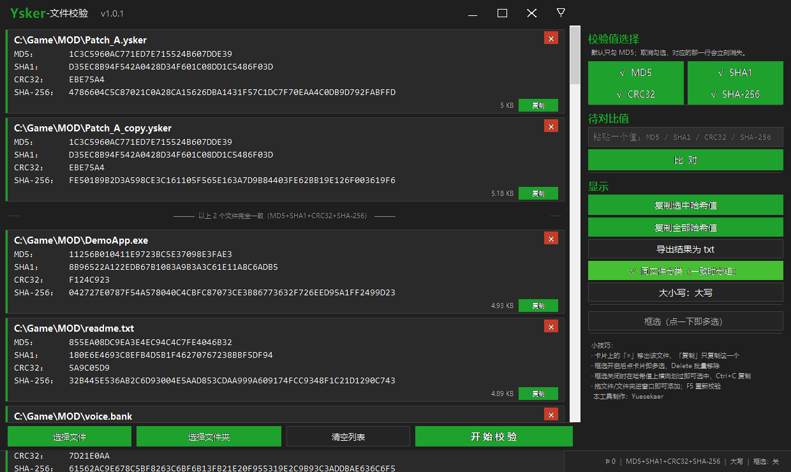

# Ysker-文件校验（Ysker-Hash-Verification）

一个纯 AI 制作、简约到简陋的哈希值校验工具 —— UI 界面没啥设计跟抽卡似的，但该有功能的应该都有了。

一个面向 Windows 的**批量文件校验小工具**：把文件拖进来，一次性算出
**MD5 / SHA1 / CRC32 / SHA-256**，可以互相对比、查重、把结果复制或导出。

单个 exe、免安装、免联网、**不读写任何配置文件**（纯绿色便携）。
技术：C# WinForms，只用 .NET 4.0 API（装有 .NET 4.x 的 Win7 SP1+ 可运行）。

真机截图：



当然，这个软件肯定不可能和专业的人制作的专业软件相比，所以如果你觉得这个软件已经垃圾到了看着都不舒服的地步，那我感到非常抱歉，
就权当是我在互联网，取其精华合成糟粕，乱丢垃圾吧(*/ω＼*)我会努力让下一次产出不再是垃圾的(シ_ _)シ

---

## 目录

- [功能特性](#功能特性)
- [快速开始](#快速开始)
- [使用方法](#使用方法)
- [快捷键](#快捷键)
- [已知限制](#已知限制)
- [开源协议](#开源协议)

---

## 功能特性

### 校验

- **四种算法自由组合**：`MD5`、`SHA1`、`CRC32`、`SHA-256`；默认只勾 MD5。
- 校验后**取消勾选**某个算法 → 卡片里对应那一行**立刻消失**；**再勾回来**会自动补算，
  并且只让新勾的这一行渐亮一次（已经算过的不重算）。
- 一个都不勾 → 状态栏提示 `至少得选一个吧(｀・ω・´)`，不会开始校验。
- 批量校验带进度：卡片顶部进度条 + 状态栏百分比，支持上千个文件。
- 单个文件读不了（被占用 / 无权限）只影响它自己，卡片上显示 `读取失败：原因`。

### 哈希值是「只读文本层」

哈希值那几行不是画出来的文字，而是真正的**系统只读文本控件**，选中手感与记事本一致：

- 左键按住拖动即可连续划选，**松开后保持高亮**（也支持从右往左拖）；
- 双击选词、`Shift+点击` 扩展、`Ctrl+A` 全选；
- `Ctrl+C` 或**右键 → 复制**，复制到的就是框住的那一段；
- **不可编辑**：输入、粘贴、剪切、删除全部无效；
- **不出现输入光标**，不激活输入法（不弹软键盘）；
- 点击软件其他空白处 → 选区消失；
- 在哈希值上滚动滚轮 → 滚动的是**文件列表**（不是文本框）。

### 内容一致的文件会「依次渐亮」

- 按算法顺序 `MD5 → SHA1 → CRC32 → SHA-256` 依次渐亮：
  同一算法的所有相关行**一起亮、一起灭**（0.1s 渐亮 → 0.6s 保持 → 0.3s 渐回白色）。
- **只有新勾上/新补算的算法才会闪**，已经闪过的不会重亮。
- 用「比对」命中时，**只让命中的那一行**单独闪。

### 同文件分类（默认关闭，可随时切换）

- **开启**：内容完全一致的文件排到最前面并按组分块，每组末尾插一条分隔线：
  `———  以上 N 个文件完全一致（MD5+SHA1+CRC32+SHA-256）  ———`，并自动滚到第一组。
- **关闭（默认）**：列表保持原顺序、不分组，但**仍然会把一致项依次渐亮**，状态栏提示
  `发现 N 组内容一致（「同文件分类」关闭，未分组显示）`。

### 待对比值

粘一个哈希值进去（回车或点「比  对」）：

- **按长度自动识别算法**：`8=CRC32　32=MD5　40=SHA1　64=SHA-256`；
- **尚未校验时会自动先校验**，算完再比对（不会误报"没有匹配"）；
- 命中 → 滚到那一行并让该行渐亮；
- 没命中 → `很遗憾，没有匹配的值(；´д｀)ゞ`；若该算法当前没勾选/没算，会附注提示；
- 比对**不会**改动列表选中项，也**不会**分组。

### 复制与导出

- **复制选中哈希值**：有选中文件时只复制选中的；没有任何选中时复制全部文件的哈希值。
- **复制全部哈希值**：不管勾选与选中，复制列表中所有文件的**四个算法全部值**。
- 每张卡片右下角的 `复制` 只复制**这一个**文件。
- **导出结果为 txt**：UTF-8（带 BOM，记事本打开不乱码），格式：

```
Ysker-文件校验  导出时间：2026-10-12 20:39:59
文件数量：12    校验值：MD5 / SHA1 / CRC32 / SHA-256    大写
------------------------------------------------------------
<完整路径>
  MD5：....
  SHA1：....
  CRC32：....
  SHA-256：....
```

### 列表与窗口

- 「选择文件」（Ctrl/Shift 多选）、「选择文件夹」（**递归子目录**）、
  或把文件/文件夹**直接拖进窗口**；重复路径不会产生重复卡片。
- **框选模式**：点一下卡片即多选、空白处拖框批量选、`Ctrl+A` 全选、`Delete` 批量移除。
- **大小写切换**：显示、复制、比对、导出全部跟随。
- **无边框自绘标题栏**：最左是「置于顶层」图钉（默认关），右侧最小化/最大化/关闭；
  窗口四边四角可缩放（最小 `1000×580`），双击标题栏空白处最大化/还原。
- **文字随窗口宽度自适应**：窗口变窄时卡片字号自动从 10.5pt 往下缩（最低 7pt），
  保证 **SHA-256 的 64 个字符永远完整显示**；路径放不下时**先把这一行的字号缩小**，
  只有连最小字号都放不下才显示成 `C:\Users\…\完整文件名`（**文件名永远完整**）。
- 侧栏使用**自绘深色滚动条**，不会出现系统原生白色滚动条。

---

## 快速开始

### 直接使用

1. 下载 `dist/Ysker-Hash-Verification.exe`（或 Releases 页里的同名附件）；
2. 双击运行（无需安装）。系统要求：**Windows 7 SP1 及以上，且已安装 .NET Framework 4.x**
   （Win10 / Win11 默认自带）。

---

## 使用方法

### 界面

```
┌──────────────────────────────────────────────────────────────┐
│ Ysker-文件校验 v1.0.1                    📌   ─   □   ✕        │ ← 自绘标题栏
├─────────────────────────────────────────┬────────────────────┤
│  文件卡片列表（可滚动）                  │  校验值选择         │
│   ┌───────────────────────────────────┐ │   □ MD5  □ SHA1    │
│   │▎ 完整路径            [×]          │ │   □ CRC32 □ SHA-256│
│   │  MD5：....            [复制]      │ │  待对比值 [______] │
│   └───────────────────────────────────┘ │   [ 比  对 ]        │
│                                         │  显示              │
│                                         │   [复制选中哈希值]  │
├─────────────────────────────────────────┤   ...              │
│ [选择文件][选择文件夹][清空列表][开始校验]│  小技巧：…          │
│                                         │   本工具制作：…     │
├─────────────────────────────────────────┴────────────────────┤
│ 状态文字…                        N 文件｜已校验 N｜选中 N｜…   │ ← 状态栏
└──────────────────────────────────────────────────────────────┘
```

- 卡片左侧是一条 **4px 绿色竖条**（已校验为亮绿，未校验为灰）；
- 卡片右下角是**文件大小**与 `复制` 按钮，右上角是 `×`（移出列表）；
- 四个键名（`MD5：` / `SHA1：` / `CRC32：` / `SHA-256：`）用等宽字体测量后统一列宽，
  **所有 `：` 落在同一列**；
- 状态栏右侧实时显示 `N 文件 ｜ 已校验 N ｜ 选中 N ｜ 算法 ｜ 大写/小写 ｜ 框选：开/关`。

## 快捷键

| 快捷键 | 作用 |
|---|---|
| `F5` | 开始（重新）校验 |
| `Ctrl+O` | 选择文件 |
| `Ctrl+F` | 查找一致文件（是否分组取决于「同文件分类」开关） |
| `Ctrl+K` / 输入框内 `Enter` | 比对输入框里的值 |
| `Ctrl+C` | 有文本选区 → 复制该片段；否则复制选中文件（无选中则全部）的哈希值 |
| `Ctrl+S` | 导出结果为 txt |
| `Ctrl+A` | 全选（框选模式） |
| `Delete` / `Backspace` | 移除选中文件 |
| `Ctrl+Delete` | 清空列表 |
| 拖放 | 把文件 / 文件夹拖进窗口即可添加 |
| 右键 | 弹出全部功能的菜单 |

---

## 已知限制

- **文件数量上限 3000 个**。
- 程序为 **DPI-unaware**：在 125% / 150% 缩放下由系统位图放大；
  但字号、字宽、列内边距都是运行期实测，对齐与"框住 = 复制"在这些缩放下依然成立。
- 无边框窗口的圆角依赖 `dwmapi`，**Win7 上无圆角**（其余功能正常）。
- 预览图由同一个渲染内核离屏生成，排版与配色可信，但**悬停态、动画过程**只有真机能看到。
- 只读文本控件在带触摸屏的设备上理论上可能唤起软键盘（已设置 `ImeMode.Disable` 抑制）；
  桌面鼠标操作不会出现该现象。

---

## 开源协议

[MIT](LICENSE) © 2026 Yuesekaer

> 开源协议：MIT ｜ 作者：Yuesekaer ｜ 界面语言：简体中文
